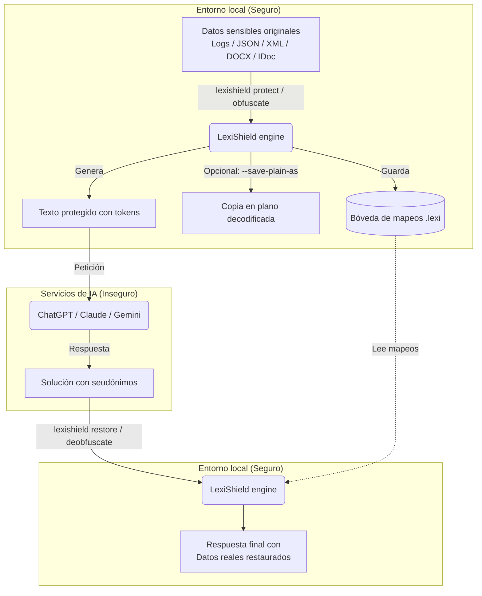
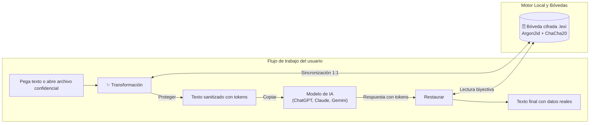

# LexiShield - Motor de protección semántica para consultas de IA y gestión de mapeos

## Una historia técnica: Aria, los modelos de IA y el escudo de privacidad

En la era dorada de los modelos de inteligencia artificial (LLMs), **Aria** ejercía como artífice de sistemas y guardiana de código en las ciudadelas interconectadas de una vasta corporación. Su día a día consistía en resolver errores complejos en los monolitos servidores ddel su reino digital. Para acelerar su labor, Aria utilizaba recurría a los oráculos de inteligencia artificial, alimentando sus mentes de silicio con volcados de memoria, arquitecturas de Active Directory, archivos de configuración herméticos, tramas industriales de SAP y pergaminos de vastos registros para que los oráculos descifraran los enigmas y crearan parches precisos.

Pero una aciaga jornada, el Alto Censor de Seguridad de la corporación proclamó una advertencia tajante:
> *“Queda terminantemente prohibido elevar datos vivos de producción hacia los oráculos externos. Si un solo pergamino revela la IP de un ciudadano, su correo auténtico, un glifo SID de Windows, una clave de bóveda o una orden encapsulada en código fuente, la corporación enfrentará la ruina y la fuga de secretos de miríadas de seres”.*

Aria se halló ante una encrucijada funesta: renunciar a la clarividencia de los oráculos y sucumbir a la condena de la burocracia, o arriesgarse a una fuga de datos. Fue entonces cuando descubrió y empuñó **LexiShield**.

### El escudo inteligente de Aria
Aria convirtió a LexiShield en su puente hermético y pasarela segura hacia los confines de la IA. La forja operaba a través de un rito riguroso:

1. **Inspección profunda y descifrado de secretos** Antes de exponer un solo byte al exterior, Aria abría su consola. El motor de LexiShield escaneaba el documento penetrando las capas más oscuras: reconocía tanto la prosa común como los conjuros de **SAP IDoc** delimitados por las runas de control invisibles (^A de campo, ^B de segmento y ^C de registro). Si los datos albergaban cargas selladas en **Base64**, **Hexadecimal** o **URL encoded**, el motor actuaba como un decodificador de runas tipo strings, abriéndolas en memoria para detectar correos, IPs, nombres de usuario y credenciales camufladas en su interior, dejando siempre intacto el pergamino original en disco sin alterar jamás su fuente.
2. **Generación coherente y bóvedas de mithril:** LexiShield no mancillaba el texto con burdos asteriscos ni tachaduras que enceguecieran a los oráculos. En su lugar, transmutaba los datos reales en alias sintéticos contextualmente impecables: la dirección real `192.168.1.104` pasaba a ser `192.168.22.84`', y el correo `marta.sanchez@empresa.com` renacía como `mail000001@acme.com`, reempaquetando las cargas codificadas en su dialecto original o permitiendo exportar una copia en texto plano legible. Toda equivalencia quedaba sellada criptográficamente en una **bóveda `.lexi`** protegida con el mithril de **Argon2id** y **ChaCha20-Poly1305**.
3. **La comunión con el oráculo:** Con su texto sanitizado pero estructuralmente perfecto, Aria lo transmitía a través del éter hacia los oráculos de la IA, dialogando en cualquiera de las seis lenguas de los pueblos digitales (inglés, español, francés, alemán, italiano o mandarín) de la Tierra Media. Siempre expectante para poder llegar añl resto de las lenguas del orbe.
4. **La respuesta del asistente:** El oráculo interpretaba la trama sin sospechar el velo de privacidad y respondía con lucidez matemática: *"La oscuridad surge del usuario user000001, cuyas credenciales colisionan al acceder al nodo IP000001 a través del puerto seguro 443"*.
5. **Restauración biyectiva y retorno a la realidad:** Con el vaticinio en sus manos, Aria invocaba la función inversa de LexiShield. El motor leía la bóveda cifrada, desenrollaba los mapeos 1:1 y restituía instantáneamente en su estación de trabajo los nombres verdaderos, servidores reales y credenciales auténticas.

¡Aria desentrañó los fallos más complejos con la velocidad de la inteligencia artificial, sin que un solo bit de información confidencial abandonara los muros de su fortaleza!

---

## Descripción general

**LexiShield** es una herramienta de consola ultrarrápida desarrollada en **Rust** (con binarios independientes libres de dependencias) diseñada para la protección y restauración semántica de datos sensibles en archivos de texto estructurado y no estructurado. Su objetivo primordial es actuar como pasarela de anonimización local y segura para compartir contextos con servicios externos sin riesgo de fugas de información.

El diseño sigue estrictamente los principios **SOLID**, buscando un alto rendimiento y un bajo consumo de memoria gracias a las características intrínsecas de Rust.

### Características principales
* **Paralelización multihilo:** Aprovecha todos los núcleos de tu CPU usando `rayon` para escanear directorios enteros en tiempo récord.
* **Telemetría y observabilidad estructurada:** Ejecución silenciosa por defecto y modo de depuración detallada (`-v`) integrado para diagnósticos completos.
* **Robusto (fuzz-tested):** Motor de parsing blindado y tolerante a fallos, verificado bajo escenarios de estrés (Fuzzing).
* **Motor híbrido (formatos y reglas personalizadas):** Soporta XML, JSON, texto plano, documentos Office (`.docx`, `.xlsx`, `.pptx`), formato **SAP IDoc** (delimitadores de control ASCII `^A`, `^B`, `^C`) y permite inyectar reglas regex propias vía configuración TOML.
* **Detección e inspección de cargas codificadas:** Decodificación biyectiva recursiva y tratamiento en memoria de cargas **Base64** (UTF-8 y UTF-16LE típico de PowerShell), **Hexadecimal** y **URL Percent-Encoding**.
* **Exportación en texto plano decodificado:** Capacidad para extraer y guardar contenidos codificados e IDoc en texto plano legible con otro nombre sin modificar el fichero original.
* **Internacionalización completa (i18n):** Arquitectura PO-First nativa estándar GNU Gettext con soporte oficial para 6 idiomas: Inglés, Español, Francés, Alemán, Italiano y Chino Mandarín.

### Flujo de operación (arquitectura)



---

## Interfaz gráfica de usuario (LexiShield GUI)

Además de la potente herramienta de consola, LexiShield incluye una aplicación de escritorio nativa multiplataforma (Linux, Windows, macOS) desarrollada con **Tauri v2**, **Svelte 4** y **TailwindCSS**, diseñada para proporcionar la máxima ergonomía, velocidad visual y seguridad local.

### Flujo de interacción en la GUI



### Pestañas y capacidades principales

1. **Transformación (protección bidireccional y auditoría preventiva):**
   * **Paneles bidireccionales editables:** Vistas simétricas de *Texto claro* y *Texto protegido* con detección inteligente de flujo (`Texto claro ➔ Texto protegido` para Proteger y `Texto protegido ➔ Texto claro` para Restaurar datos).
   * **Puente direccional dinámico:** Conmutador central interactivo (`[ 🛡️ Proteger ➔ ]` / `[ ⮜ Restaurar datos 🔄 ]`) entre paneles.
   * **Sub-vista de auditoría y desglose:** Análisis no destructivo de entidades confidenciales agrupadas por categorías semánticas (Red 🌐, Identidad 🪪, Sistemas 🖥️ y Contacto/Claves 💳) con barra de distribución cromática y opción de omitir falsos positivos antes de guardarlos.
   * **Arrastrar y soltar (*drag & drop*) dividido:** Arrastra archivos individuales o carpetas sobre la zona izquierda para proteger o sobre la derecha para restaurar datos con la bóveda.
   * **Opciones integradas al soltar archivos:** Cuadro de diálogo unificado para configurar modo copia con sufijo, preservación estricta del original, tratamiento de cargas codificadas (`reencode`, `expand_clear`, `merge`, `off`) y la opción de **guardar una copia en texto plano decodificado con otro nombre** (desempaquetando Base64/Hex/URL o tramas SAP IDoc sin ofuscar).
   * **Exportación en texto plano desde Studio:** Botón directo en la cabecera del editor para guardar el texto o cargas desempaquetadas en claro bajo una ruta personalizada.
   * **Soporte y detección SAP IDoc:** Reconocimiento instantáneo en cabeceras y barra de estado de tramas SAP IDoc con delimitadores de control ASCII (`^A` campo, `^B` segmento, `^C` registro).
   * **Modo Markdown con protección automática:** Conmutador `[ Editor / Markdown ]` que dispara la protección automática y previsualiza el resultado estructurado.
   * **Auto-copiado conmutable:** Conmutador rápido (`📋` / `📄`) para copiar automáticamente el resultado de la transformación al portapapeles.
   * **Historial de sesión en memoria RAM:** Recuperación instantánea de estados anteriores con un solo clic sin persistencia en disco (Zero-Knowledge).

2. **Pares de tokens (biyectividad 1:1 y privacidad):**
   * Visualización y administración directa del diccionario activo de correspondencias en la bóveda.
   * Campo de búsqueda y filtrado interactivo con botón `✕` de vaciado instantáneo.
   * Permite añadir pares manuales personalizados, editar sustituciones y marcar tokens a **Omitir** (`=`) para evitar reemplazos indeseados.
   * **Modo privacidad blindado:** Desenfoque automático de valores confidenciales en la tabla y en el modal de adición para compartir pantalla con total seguridad.

3. **Bóvedas Lexi y copias de seguridad:**
   * Creación, renombramiento, exportación e importación de contenedores criptográficos aislados (`.lexi`).
   * Generación y restauración de copias de seguridad de perfil completas (**Backup LexiShield** y **Restaurar LexiShield**) comprimidas con **Bzip2** y opcionalmente cifradas con AES-256.
   * **Arquitectura zero-knowledge:** Las bóvedas se protegen con contraseña maestra; la clave se deriva mediante **Argon2id** en memoria de sesión y los datos se sellan con **ChaCha20-Poly1305**.

4. **Portapapeles (modo de monitorización continua):**
   * Monitorización continua en segundo plano del portapapeles (`Ctrl+C` / `Cmd+C`) activable con un clic (`Monitorizar` / `Detener`).
   * **Compatibilidad total en Linux:** Cadena de respaldo híbrida automática con soporte nativo para Wayland (`wl-paste`/`wl-copy`), KDE Plasma (Klipper vía D-Bus) y X11 (`xclip`/`xsel`).
   * Diagnóstico activo en interfaz y notificaciones explícitas de estado ante errores de conexión.
   * Vaciado seguro del portapapeles manual o temporizado para máxima higiene en el sistema operativo.

5. **Opciones y registros:**
   * **Barra de acciones fija (Smartbar Tier 2):** Botones siempre visibles en la parte superior para guardar configuración, restablecer valores por defecto y consultar el registro de trazas sin necesidad de desplazarse.
   * **Motor de protección y nivel de alcance:** Selección del *Nivel de protección* (*Completo*, *Técnico & Red*, *Datos Personales & RGPD*), sufijo de copias protegidas y método de entrada de archivos.
   * **Comportamiento de ventana (cerrar y minimizar):** Configuración independiente de la acción del botón cerrar `[X]` (minimizar a la bandeja del sistema en segundo plano o salir de la aplicación) y opción para enviar la ventana a la bandeja también al pulsar minimizar `[-]`.
   * **Atajos de teclado centralizados:** Acceso inmediato a la guía de atajos de teclado (`⌨️`) desde el modal de Ayuda (`?`) o desde cualquier vista.
   * Selección de pestaña predeterminada al arrancar, personalización de pestañas visibles en la barra superior y barra CLI docking en vivo.
   * Consola de telemetría y diagnóstico en vivo con niveles de filtrado (`INFO`, `WARN`, `ERROR`, `DEBUG`).

### Ergonomía visual, accesibilidad e internacionalización
* **Multiidioma completo (i18n):** Interfaz 100% traducida en **Español**, **Inglés**, **Francés**, **Alemán**, **Italiano** y **Chino Mandarín** (con redacción natural en modo frase para español). Selector de idioma instantáneo en Opciones.
* **Modo claro / modo oscuro:** Conmutador de tema con paleta de alto contraste acorde a los más exigentes estándares de diseño de interfaces.
* **Ayuda contextual integrada:** Manual navegable disponible en cualquier momento desde todas las pestañas con `?` o el botón de ayuda.
* **Tarjetas de bienvenida e inducción:** Consejos de primer uso guiados y descartables de forma permanente.

---

## Interfaz de línea de comandos (la CLI)

El binario `lexishield` proporciona una interfaz por consola directa y eficiente. A diferencia de versiones anteriores, esta versión en Rust centraliza las operaciones en tres comandos principales.

### Estructura general de comandos
```bash
# Formato general
lexishield [GLOBAL_OPTIONS] <COMMAND> [OPTIONS]

# Opciones Globales:
#  -v, --verbose    Activa el modo de depuración estructurada (Telemetría)
#  --config <PATH>  Ruta a un archivo TOML de configuración personalizado
#  --rules <PATH>   Ruta a un archivo TOML de reglas personalizadas
#  --lang <LANG>    Idioma de la interfaz ('en', 'es', 'fr', 'de', 'it', 'zh')
```

### 1. Comando: `protect` (alias `obfuscate` / `p`)
Protege un archivo, un directorio completo (recursivamente), texto directo o el portapapeles reemplazando los datos confidenciales por tokens coherentes. Ambos nombres (`protect` y `obfuscate`) son equivalentes en la CLI.

* **`-i, --input <PATH>`**: Archivo o directorio de entrada a proteger. Si se indica un directorio, explora todos sus archivos respetando `.gitignore` y `.lexiignore`.
* **`-r, --recursive <BOOL>`**: Explora subdirectorios de forma recursiva cuando la entrada es una carpeta (por defecto: `true`).
* **`-o, --output <PATH>`**: Archivo o directorio de salida donde guardar el resultado.
* **`--copy`**: Guarda el resultado como una copia sufijada (`.protegido`) en vez de sobrescribir el original.
* **`--export-md [PATH]`**: Exporta documentos Office (`.docx`, `.xlsx`, `.pptx`) protegidos a Markdown (`.md`) extrayendo imágenes mediante Pandoc para revisión contextual con IA.
* **`-t, --text <STRING>`**: Texto directo a procesar (si no se especifica archivo).
* **`-c, --clipboard`**: Procesa de forma atómica el contenido actual del portapapeles y copia el resultado de vuelta.
* **`-f, --format <FORMAT>`**: Formato estructurado (`auto`, `json`, `xml`, `log`, `text`, `idoc`). Por defecto es `auto` (detecta automáticamente JSON, XML, Logs y tramas SAP IDoc con delimitadores `0x01`, `0x02`, `0x03`).
* **`--encoded-mode <MODE>`**: Tratamiento de cargas codificadas en Base64/Hex/URL (`reencode` para proteger el interior y re-codificar, `clear` para expandir o `off` para ignorar).
* **`--merge-chunks`**: Une fragmentos multiparte codificados correlativos al expandir en claro.
* **`--save-plain-as <PATH>`**: Guarda una versión del contenido decodificada a texto plano legible con otro nombre (sin ofuscar), preservando intacto el archivo original.
* **`-s, --save-mappings <FILE>`**: Ruta donde guardar la tabla de mapeos generada (soporta JSON o bóvedas cifradas `.lexi`).
* **`-p, --password <PASSWORD>`**: Contraseña para cifrar la tabla de mapeos guardada (Argon2id + ChaCha20-Poly1305).
* **`--ask-password`**: Solicita la contraseña de cifrado interactivamente de forma oculta en consola.
* **`-y, --yes`**: Confirma automáticamente advertencias de recursos o procesamiento masivo desatendido.

*Ejemplos:*
```bash
# Proteger archivo individual y guardar mapeos cifrados con contraseña
lexishield protect -i server_logs.json -o logs_seguros.json -s mapeos.lexi -p "MiContraseña123!"

# Proteger un directorio completo de documentos de forma recursiva y desatendida
lexishield protect -i ./documentos_internos/ -o ./documentos_protegidos/ -s mapeos.lexi -p "MiContraseña123!" -y

# Proteger un documento Office exportándolo a la vez a Markdown
lexishield protect -i informe_auditoria.docx --export-md

# Proteger directamente lo que tienes copiado en el portapapeles (One-Shot)
lexishield protect -c
```

### 2. Comando: `restore` (alias `deobfuscate` / `r`)
Restaura un archivo, un directorio completo (recursivamente), texto o portapapeles reemplazando los tokens por sus valores originales mediante una tabla de mapeos guardada previamente (JSON plano o `.lexi` cifrado). Ambos nombres (`restore` y `deobfuscate`) son equivalentes en la CLI. Si no se especifica ruta de salida con `-o`, se genera automáticamente con el sufijo `.restaurado`.

* **`-i, --input <PATH>`**: Archivo o directorio de entrada a restaurar.
* **`-r, --recursive <BOOL>`**: Explora subdirectorios de forma recursiva cuando la entrada es una carpeta (por defecto: `true`).
* **`-o, --output <PATH>`**: Archivo o directorio de salida.
* **`--export-md [PATH]`**: Exporta el documento Office restaurado a Markdown (`.md`) mediante Pandoc.
* **`-t, --text <STRING>`**: Texto directo a restaurar.
* **`-c, --clipboard`**: Restaura el texto copiado en el portapapeles y lo reemplaza con el texto real.
* **`-m, --mappings <FILE>`**: Archivo con los mapeos a aplicar (detecta automáticamente si está cifrado o en texto plano).
* **`-p, --password <PASSWORD>`**: Contraseña de descifrado (si el archivo está protegido).
* **`--ask-password`**: Pide la contraseña por consola. Si el archivo está cifrado y no pasas contraseña, te la pedirá automáticamente.
* **`-f, --format <FORMAT>`**: Formato de lectura/escritura (`auto`, `json`, `xml`, `log`, `text`, `idoc`).
* **`--save-plain-as <PATH>`**: Guarda una versión decodificada en texto plano con otro nombre.
* **`-y, --yes`**: Confirma automáticamente advertencias de recursos en modo desatendido.

*Ejemplos:*
```bash
# Restaurar un archivo devuelto por la IA
lexishield restore -i respuesta_ia.txt -o respuesta_real.txt -m mapeos.lexi -p "MiContraseña123!"

# Restaurar recursivamente un directorio completo de archivos protegidos
lexishield restore -i ./documentos_protegidos/ -o ./documentos_restaurados/ -m mapeos.lexi -p "MiContraseña123!" -y
```

### 3. Comando: `scan`
Escanea un archivo, texto, directorio o portapapeles y muestra los datos sensibles detectados (para auditoría) sin modificarlos ni reemplazarlos. Permite revisar de manera interactiva (fichero a fichero) qué se va a cambiar y guardarlo para uso futuro.

* **`-i, --input <PATH>`**: Archivo o directorio a escanear. Si es directorio, lo recorrerá mostrando progreso en tiempo real y preguntando por cada archivo.
* **`-t, --text <STRING>`**: Texto a escanear.
* **`-c, --clipboard`**: Escanea directamente el contenido del portapapeles.
* **`-s, --save-mappings <FILE>`**: Guarda los mapeos detectados tras la confirmación interactiva del usuario.
* **`-p, --password <PASSWORD>`**: Contraseña para proteger la bóveda de mapeos si decides guardarla (`.lexi`).
* **`--ask-password`**: Solicita la contraseña por consola de forma segura.
* **`-y, --yes`**: Guarda los mapeos detectados automáticamente omitiendo la revisión interactiva.

*Ejemplo (Auditoría interactiva de un directorio):*
```bash
# Escanea todos los archivos de la carpeta, indicando progreso de lectura en la misma línea (ej. [ 3.1 KB / 10 MB ]).
# Por cada archivo con descubrimientos nuevos, pausará la ejecución para mostrar los pares y preguntará qué índices deseas omitir.
lexishield scan -i /var/log/app/ -s mapeos.lexi --ask-password
```
*Durante el escaneo interactivo de un fichero, podrás:*
1. **Ver resultados paginados:** Si hay más de 20 detecciones, la lista se pausa. Pulsa `Enter` para ver más o `q` para saltar al final.
2. **Omitir detecciones falsas:** Al finalizar la lista del fichero, el programa te preguntará qué índices deseas omitir. Puedes introducir listas o rangos separados por comas (ej. `1, 3-5`). Estos elementos se guardarán con el valor especial `=` en el diccionario, asegurando que no se reemplacen por tokens.

*Ejemplo (Auditoría automatizada):*
```bash
# Escanea y guarda silenciosamente el diccionario en texto plano JSON
lexishield scan -c -s mapeos.json -y
```

### 4. Comando: `watch` (monitorización en tiempo real)
Monitoriza continuamente el portapapeles mediante eventos nativos del sistema operativo y supresión de eco. Cada vez que pulses `Ctrl+C` para copiar un texto, LexiShield lo transformará automáticamente.

* **`-d, --direction <DIRECTION>`**: Dirección de transformación: `protect` (por defecto, alias `obfuscate`) o `restore` (alias `deobfuscate`).
* **`-m, --mappings <FILE>`**: Archivo para sincronizar y persistir mapeos (JSON o `.lexi` cifrado).
* **`-p, --password <PASSWORD>`**: Contraseña si los mapeos van a guardarse o leerse cifrados.
* **`-f, --format <FORMAT>`**: Formato estructural esperado.

*Ejemplos:*
```bash
# Modo guardián cifrado: todo lo que copies se protege y los mapeos se guardan en la bóveda protegida
lexishield watch --direction protect -m mapeos.lexi -p "MiContraseña123!"

# Modo restauración: todo lo que copies de la IA se restaurará automáticamente usando la bóveda
lexishield watch --direction restore -m mapeos.lexi -p "MiContraseña123!"
```

### 5. Comando: `dict`
Gestiona diccionarios de mapeos (soporta tanto JSON plano como bóvedas cifradas):

* **`lexishield dict list -m mapeos.lexi -p "pwd"`**: Lista todos los pares registrados en la bóveda.
* **`lexishield dict add -o "usuario.real" -p "user0001" -m mapeos.lexi -p "pwd"`**: Inyecta un par en la bóveda.
* **`lexishield dict clear -m mapeos.lexi -p "pwd"`**: Vacía el diccionario cifrado.

### 6. Comando: `config` (configuración y reglas TOML)
Permite inspeccionar, ubicar y restablecer la configuración global del usuario (`~/.lexishield/config.toml`) y el archivo modular de reglas (`~/.lexishield/rules.toml`), donde se pueden definir parámetros de escaneo, exclusiones y **reglas de detección personalizadas** (Custom Regex):

* **`lexishield config show`**: Muestra en consola el contenido del archivo de configuración activo.
* **`lexishield config path`**: Muestra la ruta física del archivo `config.toml`.
* **`lexishield config reset`**: Restablece los archivos a las plantillas por defecto con ejemplos explicados.
* **`lexishield --config /ruta/personalizada.toml --rules /ruta/mis_reglas.toml <COMMAND>`**: Permite usar archivos de configuración y reglas alternativos en cualquier comando.

*Ejemplo de Reglas Personalizadas en `~/.lexishield/rules.toml`:*
```toml
# Reglas dinámicas personalizadas sin recompilar
[[rules]]
name = "Identificador de Empleado"
pattern = '(?i)\bEMP-\d{4,6}\b'
prefix = "EMP-"
strategy = "random_digits"

[[rules]]
name = "Código de Proyecto Interno"
pattern = '(?i)\bPRJ-[A-Z0-9]{3,6}\b'
prefix = "PRJ-"
strategy = "random_alphanumeric"

[[rules]]
name = "Token de Acceso a Servicios"
pattern = '(?i)\b(ghp|glpat|npm)_[a-zA-Z0-9]{20,}\b'
strategy = "mask"
```

### 7. Soporte para tuberías Unix (pipes y `stdin`)
LexiShield garantiza pureza estricta de CLI (la telemetría se emite exclusivamente por `stderr`), lo que permite encadenar comandos en pipelines de Unix sin corromper la salida:

```bash
# Procesar archivo por tubería a stdout
cat access.log | lexishield obfuscate > access_safe.log

# Monitorizar en tiempo real un archivo de log continuo (streaming)
tail -f /var/log/nginx/access.log | lexishield obfuscate -i -

# Escanear datos enviados por echo
echo "Contacto: soporte@empresa.com" | lexishield scan --stdin
```

### 8. Filtrado de archivos y soporte `.lexiignore`
Durante escaneos recursivos de directorios (`lexishield scan -i /ruta/`), LexiShield ignora automáticamente archivos binarios (`.pdf`, `.exe`, `.jpg`, `.zip`), metadirectorios (`.git`, `node_modules`, `target`, `dist`) y respeta archivos `.gitignore` y **`.lexiignore`** personalizados dentro de tus carpetas.

### 9. Comando: `completions` (autocompletado nativo)
Genera scripts de autocompletado nativo para la terminal:

```bash
# Bash
source <(lexishield completions bash)

# Zsh
lexishield completions zsh > ~/.zfunc/_lexishield

# PowerShell
lexishield completions powershell | Out-String | Invoke-Expression

# Fish
lexishield completions fish > ~/.config/fish/completions/lexishield.fish
```

---

## Documentación técnica para desarrolladores

Si te interesa conocer las entrañas de LexiShield, cómo funciona el motor, o quieres compilar el proyecto tú mismo, hemos separado toda la información técnica en los siguientes documentos:

* **[Arquitectura y motor de mapeo (docs/architecture.md)](docs/architecture.md)**: Explicación detallada de los detectores, la inyectividad de los diccionarios, y el tratamiento de JSON/XML.
* **[Guía de compilación oficial con DevForge (docs/contributing.md)](docs/contributing.md)**: Instrucciones para compilar en modo nativo o generar binarios multiplataforma aislados (Windows, Linux, macOS) mediante dev-forge.
