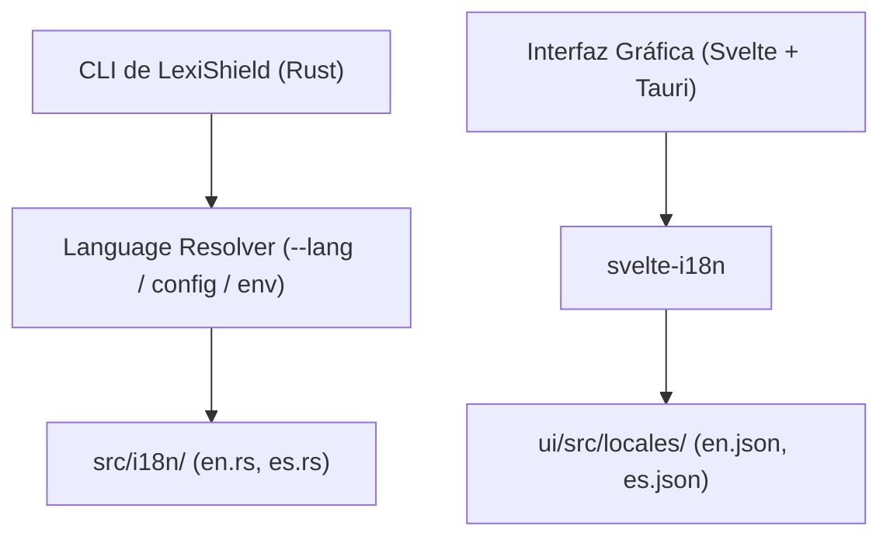

# Guía de Internacionalización (i18n) y Gestión de Idiomas

LexiShield cuenta con una arquitectura de internacionalización modular y desacoplada que abarca tanto la **interfaz de usuario (Svelte + Tauri)** como la **interfaz de línea de comandos y motor central (Rust)**.



---

## 1. Cómo Agregar un Nuevo Idioma

### Paso 1: En la Interfaz Gráfica (Svelte)
1. Crea el catálogo JSON en `ui/src/locales/<código>.json` (por ejemplo, `fr.json` para francés) copiando las claves de `en.json`:
   ```json
   {
     "tabs": {
       "studio": "Studio",
       "scanner": "Scanner", ...
     }
   }
   ```
2. Registra el nuevo idioma en `ui/src/i18n.js`:
   ```javascript
   register("fr", () => import("./locales/fr.json"));
   ```

### Paso 2: En el Motor y CLI (Rust)
1. Añade la variante al enum `Language` en `src/i18n/mod.rs`:
   ```rust
   pub enum Language {
       En,
       Es,
       Fr,
   }
   ```
2. Crea el módulo de traducciones en `src/i18n/fr.rs`:
   ```rust
   use super::MsgKey;

   pub fn translate(key: MsgKey) -> &'static str {
       match key {
           MsgKey::CliAbout => "Moteur d'anonymisation et protection sémantique...",
           // El compilador de Rust verificará exhaustivamente todas las claves
       }
   }
   ```
3. Declara el módulo en `src/i18n/mod.rs`:
   ```rust
   #[cfg(feature = "lang-fr")]
   pub mod fr;
   ```
4. Agrega la feature opcional en `Cargo.toml`:
   ```toml
   [features]
   default = ["lang-en", "lang-es"]
   lang-en = []
   lang-es = []
   lang-fr = []
   ```

---

## 2. Reducción del Impacto en Disco y Poda de Idiomas

LexiShield permite eliminar fácilmente los idiomas que no se deseen utilizar para generar binarios y distribuciones con el menor tamaño posible:

### En Rust (Exclusión en tiempo de compilación)
Para compilar un binario ultraligero que contenga exclusivamente el idioma deseado y cero bytes de otros idiomas:
```bash
# Compilar únicamente con idioma inglés:
cargo build --release --no-default-features --features lang-en

# Compilar únicamente con idioma español:
cargo build --release --no-default-features --features lang-es
```

### En el Frontend Web (Poda de catálogos JSON)
Utiliza el script de poda antes de compilar el paquete:
```bash
# Mantener únicamente el idioma inglés:
./scripts/prune_locales.sh en

# Mantener inglés y español:
./scripts/prune_locales.sh en,es
```
El empaquetador Vite omitirá automáticamente los idiomas excluidos del paquete final `dist/`.

