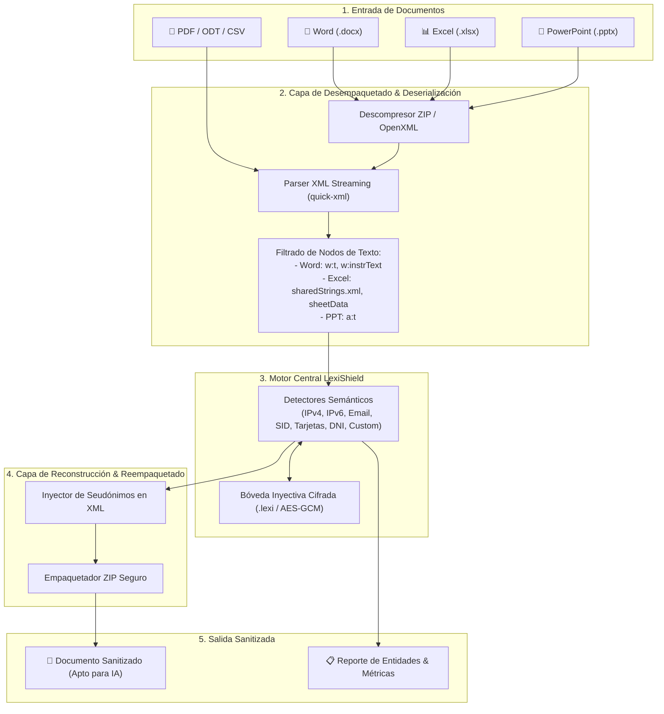

# Especificación técnica: LexiShield v2.1.0 (Office & Document Engine)

> **Estado**: Planificación / Hoja de Ruta  
> **Versión Objetivo**: `2.1.0`  
> **Módulo Principal**: `lexishield::engine::office`

---

## 1. Visión y objetivos

La versión **2.1.0** de LexiShield amplía el motor de ofuscación semántica más allá del texto plano, logs y fragmentos de código, incorporando soporte nativo para **documentos ofimáticos de Microsoft Office (DOCX, XLSX, PPTX)** y formatos abiertos (**ODT, ODS, PDF, CSV**).

### Objetivos clave:
1. **Preservación estricta del formato**: Transformar datos confidenciales sin alterar estilos, tipografías, tablas, celdas, saltos de página ni estructuras internas del documento.
2. **Biyección y reversibilidad total**: Permitir la restauración bidireccional (desofuscación) de las respuestas generadas por modelos de IA sobre los mismos documentos.
3. **Cero fugas en disco**: Procesamiento en memoria (*in-memory streaming*) o uso de buffers seguros efímeros sin dejar copias temporales en claro.
4. **Soporte multiplataforma**: Implementación 100% Rust sin dependencias de COM de Windows, Microsoft Office instalado ni servicios externos.

---

## 2. Diagrama de arquitectura del pipeline de documentos



---

## 3. Especificación técnica por formato

### 3.1 Microsoft Word (`.docx`)
* **Estructura interna**: Contenedor ZIP con `word/document.xml`, `word/header*.xml`, `word/footer*.xml`, `word/comments.xml` y `word/footnotes.xml`.
* **Nodos objetivo**:
  * `<w:t>`: Nodos de texto en ejecuciones (*runs*).
  * `<w:instrText>`: Códigos de campo (hipervínculos, metadatos, etc.).
* **Reto técnico (fragmentación de runs)**: Los editores de texto suelen dividir palabras en múltiples runs `<w:r>` tras autocorrecciones o cambios de formato.
  * *Solución*: Unificación lógica del texto del párrafo antes del análisis con mapeo de índices hacia los runs originales.

### 3.2 Microsoft Excel (`.xlsx`)
* **Estructura interna**: `xl/sharedStrings.xml` y `xl/worksheets/sheet*.xml`.
* **Nodos objetivo**:
  * `<t>` en `sharedStrings.xml`: Diccionario global de cadenas compartidas de la hoja de cálculo.
  * `<v>` en celdas de tipo texto explícito (`inlineStr`).
* **Preservación de fórmulas**: Las fórmulas `<f>` se analizan para sustituir literales de texto confidenciales sin romper referencias de celdas (`A1:B10`).

### 3.3 Microsoft PowerPoint (`.pptx`)
* **Estructura interna**: `ppt/slides/slide*.xml` y `ppt/notesSlides/notesSlide*.xml`.
* **Nodos objetivo**:
  * `<a:t>` dentro de cuadros de texto, tablas y notas del orador.

### 3.4 Formatos adicionales
* **PDF (`.pdf`)**: Extracción de texto y análisis forense de entidades confidenciales (con advertencia de solo lectura / generación de resumen).
* **CSV / TSV**: Procesamiento directo con delimitador configurable y detección de cabeceras.

---

## 4. Interfaces de usuario (CLI y GUI)

### 4.1 Nuevos comandos en la CLI

El procesamiento de documentos Office se integra de forma transparente en los comandos universales de LexiShield:

```bash
# Ofuscación / protección directa de documento Office
lexishield protect -i auditoria_2026.docx -o auditoria_sanitizada.docx -s prod.lexi

# Desofuscación / restauración de documento devuelto por la IA
lexishield restore -i auditoria_procesada_ia.docx -o auditoria_restaurada.docx -m prod.lexi

# Procesamiento por lotes sobre una carpeta completa (soporta recursión)
lexishield protect -i ./reportes_confidenciales/ --copy -s prod.lexi

# Escaneo y auditoría pasiva de un documento sin modificarlo
lexishield scan -i auditoria_2026.docx

# Exportación automática a Markdown con Pandoc para revisión contextual con IA
lexishield protect -i manual_empleado.docx --export-md
```

### 4.2 Integración en la interfaz gráfica (GUI)
1. **Zona de arrastre (*drag & drop*)**: El usuario puede arrastrar archivos `.docx`, `.xlsx` o `.pptx` a la pestaña **Transformación**.
2. **Visor de resumen previo**:
   * Recuento de tablas y párrafos procesados.
   * Lista desglosada de entidades sensibles detectadas con opción de omitir falsos positivos.
3. **Botón de exportación directa**: Descarga con un solo clic del archivo sanitizado listo para enviar a ChatGPT / Claude / DeepSeek.

---

## 5. Hoja de ruta de implementación (fases)

| Fase | Hito | Descripción |
| :---: | :--- | :--- |
| **Fase 2.1** | *OpenXML Word Core* | Parser y reempaquetador de `.docx` con soporte de párrafos, tablas y encabezados. |
| **Fase 2.2** | *OpenXML Excel & PowerPoint* | Soporte para `sharedStrings` en `.xlsx` y cajas de texto en `.pptx`. |
| **Fase 2.3** | *Integración CLI Office* | Soporte transparente en comandos `protect`, `restore` y `scan` con opción `--export-md`. |
| **Fase 2.4** | *GUI Drag & Drop* | Integración en la interfaz Tauri/Svelte de carga de archivos y previsualización. |
| **Fase 2.5** | *Test Suite & Benchmarks* | Validación con documentos masivos (>100 MB / >50,000 celdas) y verificación de integridad XML. |

### 5.1 Estado de implementación de la interfaz gráfica (GUI v2.1.0)

| Fase GUI | Alcance | Estado | Descripción |
| :---: | :--- | :---: | :--- |
| **Fase 1** | *Ergonomía, Temas & Packaging* | **COMPLETADA** | Modo Oscuro/Claro con paleta de alto contraste, diseño accesible de pestañas activas, iconos nativos de ventana y sistema en Linux/Windows/macOS, y optimización del script de compilación para descartar dependencias innecesarias en el staging. |
| **Fase 2** | *Onboarding, Tokens & Telemetría* | **COMPLETADA** | Explicador de requisitos criptográficos (*Zero-Knowledge Onboarding*), ayuda contextual con `❔ Ayuda` y tarjetas de primer uso descartables en todas las pestañas, terminología estandarizada a tokens, integración con Pandoc y desofuscación 1:1, modales con métricas de resultados, modo Watch con notificación de 0 tokens y preview de portapapeles, y telemetría estructurada sin advertencias. |
| **Fase 3** | *Smartbars Tier 2 & Simplificación de Opciones* | **COMPLETADA** | Unificación de barras secundarias (Smartbars Tier 2) en todas las vistas incluida Opciones, selectores limpios sin iconos, reorganización de preferencias en 4 bloques funcionales (*Motor de Protección*, *Ventana y Sistema*, *Portapapeles*, *Apariencia y Seguridad*) y control granular de minimización/cierre en bandeja. |

---

## 6. Consideraciones de seguridad y calidad

1. **Validación de integridad XML**: Antes de emitir el archivo final, el motor parsea el XML de salida para asegurar que es 100% válido y que Word/Excel no emitirán advertencias de "archivo dañado".
2. **Defensa contra XML External Entity (XXE) y Zip Bombs**: El analizador inspecciona previamente las cabeceras del contenedor ZIP (`inspect_zip_resources`), calculando el volumen total descomprimido y contrastándolo con la memoria RAM disponible del equipo, solicitando confirmación explícita al usuario si el archivo supera umbrales de seguridad o ratios de compresión anómalos.
3. **Sanitización de subprocesos externos (Pandoc)**: Toda ruta pasada a herramientas externas es validada mediante `validate_external_cli_path` para impedir inyección de flags (`-`), caracteres de control y recorridos de directorios no autorizados, aislando los argumentos con `--`.
4. **Limpieza de metadatos ocultos**: Opción configurable (`--strip-metadata`) para limpiar autor original, comentarios eliminados y rutas UNC incrustadas en el documento.

